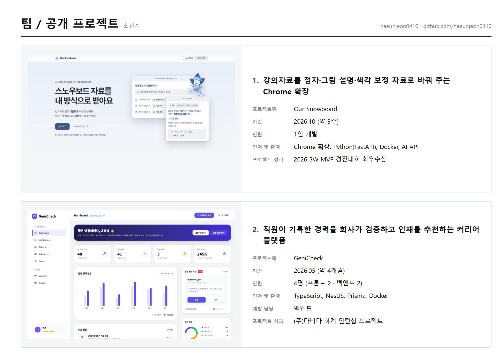

# portfolio-cards

GitHub 저장소 기반 카드형 A4 PDF 포트폴리오 생성 앱. 로컬 실행 전용.

## 기능

- 저장소 수집: 변경분만 갱신
- 완성 판단: README 스크린샷 유무 기준 (코드·커밋 수는 주의 표시)
- 새 저장소: 업데이트 시 1회 확인, 제외한 저장소는 재질문 없음
- 자동 입력: 기간(코드 커밋), 인원·역할(README 팀 표), 언어·환경, 사진(README 이미지)
- 카드 수정: 구분(팀/개인), 설명, 성과, 사진 최대 3장
- 출력: 화면과 동일한 렌더링의 PDF

## 실행

- 요구 사항: Node.js 22+, `gh auth login`(또는 `GITHUB_TOKEN`), Chrome/Edge
- `npm start` 후 http://127.0.0.1:4173 (Windows: `포트폴리오 열기.vbs`)

## 데이터

| 경로 | 내용 |
|---|---|
| `data/overrides.json` | 포함·제외 저장소, 수정값 (변경 시 `data/backups/` 자동 백업) |
| `data/config.json` | README에서 본인 행을 찾는 이름 목록 |
| `.cache/` | 수집 결과, 내려받은 사진 |

위 경로는 `.gitignore` 제외. 형식 예시는 `data/overrides.example.json`.

## 구조

| 경로 | 역할 |
|---|---|
| `lib/collect.js`, `lib/github.js` | GitHub 수집 |
| `lib/judge.js` | 완성 판단, 팀 표·기간 추출 |
| `lib/build.js` | 카드 목록 병합, 입력 검증, 백업 |
| `lib/pdf.js` | Chrome 제어 PDF 출력 |
| `public/` | 화면·PDF 공용 렌더링 |

테스트: `npm test`

## 보안

127.0.0.1 전용. Host/Origin 검사, 요청 크기 제한, 폴더 밖 접근 차단, 입력 검증.
